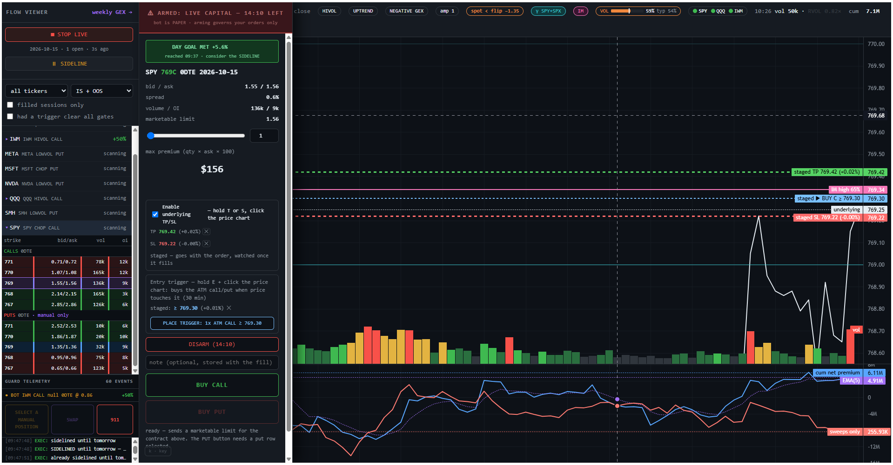
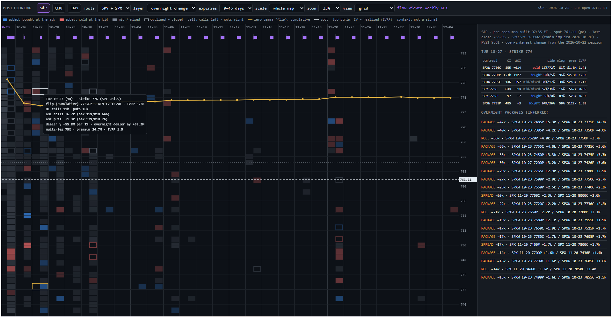
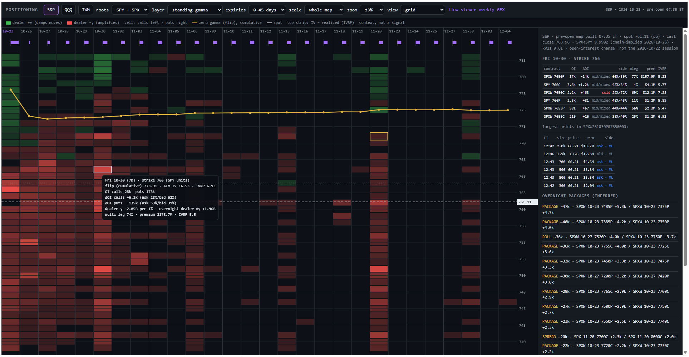
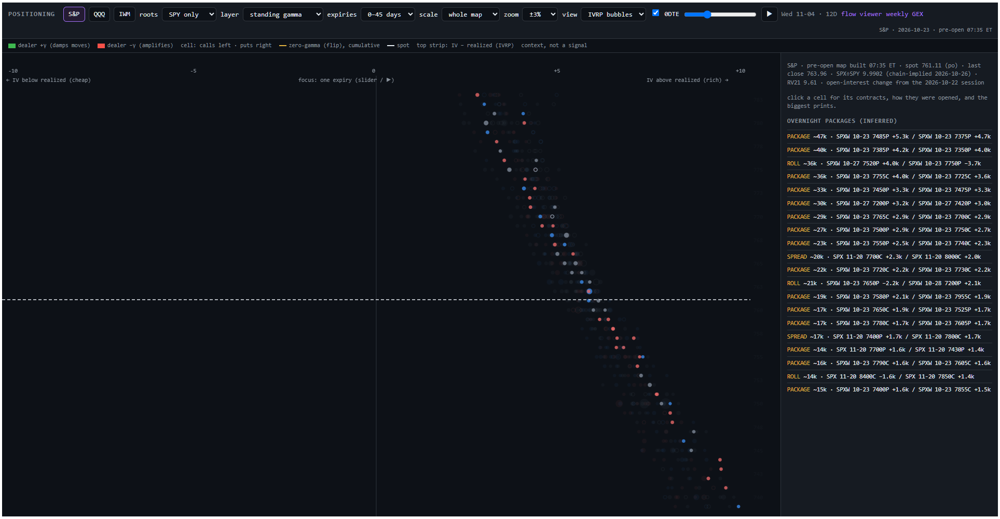
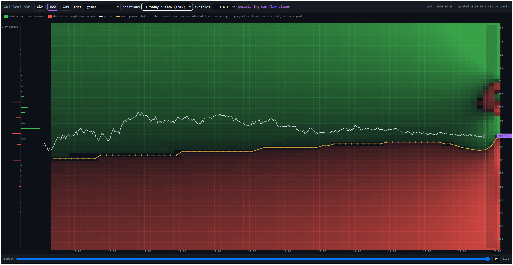
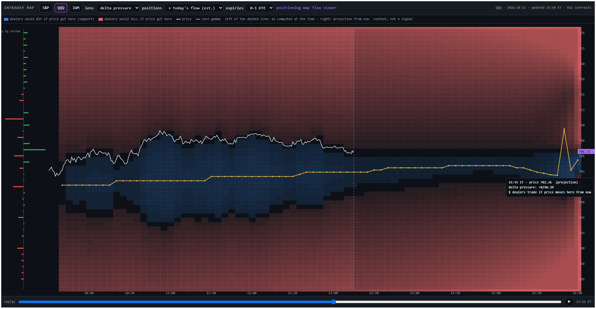
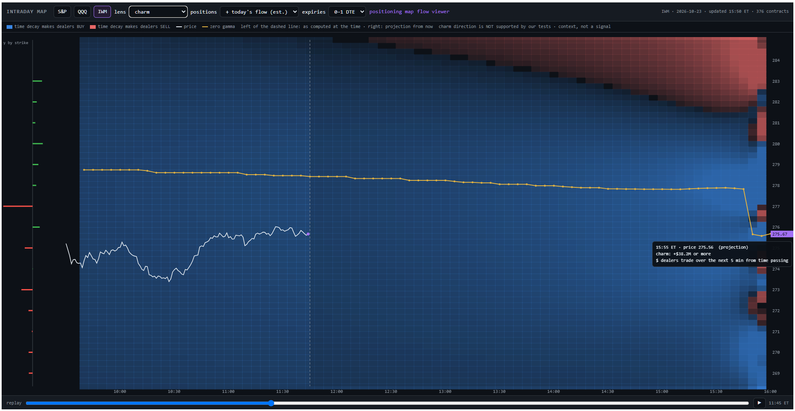

# WeBullRG

A directional 0DTE/1DTE options bot and the research toolkit that produced it.

The bot reads options order flow from [Unusual Whales](https://unusualwhales.com),
takes a position when cumulative intraday net premium crosses its own moving
average and the move clears a percentile gate, executes through Webull, and
manages the exit with a bracket. Around it sits ~180 single-purpose research
scripts — each one a hypothesis with a stated prior and a falsification
condition — plus a browser chart for watching the tape live and placing
discretionary orders by hand.

---

## ⚠️ Read this before running anything

**This software places real orders with real money.** It is published as a
record of a method, not as a product, and it carries no warranty of any kind.

- **There are no performance claims here.** Nothing in this repository asserts
  that the strategy is profitable. `FORWARD_SHOOTOUT.md` and `PRESAMPLE_PLAN.md`
  are pre-registered tests, written before the data was scored, and both are
  still substantially unrun. Read them for what is and is not established.
- **`DRY_RUN=true` is the default and nothing overrides it silently.** The bot
  sends no orders until you set it to `false` yourself.
- **Options can expire worthless.** 0DTE positions can lose their entire premium
  in minutes, and the exit logic depends on a bracket that the broker may not
  fill at the price you asked for. A limit price is not the price you get.
- Nothing here is financial, legal or tax advice, and the authors are not your
  broker, adviser or counterparty.

Trade paper first, for longer than feels necessary.

---

## 🔒 Hyperliquid perpetuals are locked, deliberately

The repository contains a Hyperliquid client (`hyper_exposure_client.py`) used by
an experimental delta-hedging engine. **It is disabled by default and cannot be
enabled by accident.**

```sh
python hl_gate.py      # prints the legal notice and the current arm state
```

Hyperliquid perpetual futures are leveraged derivatives on an offshore exchange
that is not registered with the CFTC. **For US persons, trading them is
generally not lawful** unless you meet the "eligible contract participant"
threshold — an asset-based test that ordinary retail traders do not meet.
Hyperliquid's own terms of service separately restrict US persons. Using a VPN
or a non-US wallet to get around that does not make it lawful and may add
offences of its own.

Enabling it therefore requires **two independent things**: a capability flag
*and* a copied-out legal attestation, on top of the global `DRY_RUN`, a
per-order notional cap and an explicit coin allow-list. Every limit fails
closed — an unset cap refuses everything rather than permitting anything. The
full reasoning is in the module docstring of [`hl_gate.py`](hl_gate.py).

**The rest of the toolkit does not need it.** Nothing in `bot_runner.py`'s path
imports Hyperliquid. If you are not certain you are eligible, leave every
`HL_*` variable unset and everything else works exactly as documented.

---

## Screenshots

**Live flow viewer (`flow_viewer.html`), QQQ.** Price with session VWAP,
the 0–1DTE gamma heat by strike and the gamma flip, volume bars shaded by
relative volume, and below them the flow pane the bot trades on: cumulative
net premium, its EMA(5), and sweeps-only flow.


**GEX with the index added (`γ SPY+SPX`).** The cyan heat is SPY's 0–1DTE
gamma plus SPX's, mapped onto SPY's price by the session's median SPX/SPY
ratio (SPX carries most of the near-dated S&P gamma — about 86% of it on
2026-10-01, the session shown). A strike where the index dominates is labelled with the SPX strike
behind it (`γ −4682.9M · SPX 7625` at 760), and the index's own biggest
strikes are drawn dotted at their exact mapped price (`SPX 7650 put` at
762.41) — two or three dollars off SPY's round numbers. The γ pill in the bar
or `g` toggles it; QQQ+NDX and IWM+RUT work the same way, and the weekly page
has the same switch. The dashed gamma flip stays SPY's own.


**Strike strip.** Each tradeable ETF drops down to its live basket — the
0DTE calls a rule trades and the puts kept for discretionary orders — with
bid/ask, volume and open interest, re-centred on spot as price moves.


**Staging a manual order.** A marketable limit, the maximum premium it can
commit, and a 15-minute arming window that has to be opened before any order
can leave. (The account figure under the premium is blurred.)


**Underlying TP/SL.** With it enabled, T + click on the price chart sets a
take-profit and S + click a stop-loss at that UNDERLYING price — on a live
manual hold, or, as here, staged with an order (dashed until it fills). The
bot watches the levels itself, needs price through a level for 2 seconds
before acting, and closes marketable with the same 911 escalation as the
Close button. A level on the wrong side of spot for the option's direction
is refused. (The account figure under the premium is blurred.)


**Sideline.** Done for the day, as a switch rather than a resolution. Two
clicks under GO LIVE disarm the desk and refuse every arm and entry until the
next session; the bot holds it, so a reload, another tab or a restart cannot
lift it. Exits still work. Coming back early means answering one question —
Yes lifts it, No keeps it — and every answer is logged with a note, so the
days you came back in can be looked at later.


**Entry trigger, day goal, volatility gauge and wait lights.** One staged
trade, built in a single pass: hold **E** and click the chart for the entry,
**S** for the stop, **T** for the target, then *PLACE TRIGGER*. (The day
goal's dollar figure and the account line under the premium are removed.)



- **Entry trigger** (blue dashed line, `staged ▶ BUY C ≥ 769.30`). "Buy the
  at-the-money call or put when price *touches* this level." Webull cannot hold
  an option order conditional on the underlying, so the bot holds it. It fires
  on the first touch (no 2-second hold, unlike the stops), buys the contract
  that is ATM *at the touch*, and re-runs every entry guard at that moment:
  spread, quote age, 15:55, one hold per ticker, and the exposure cap, which
  may cut the quantity. You have to be armed to place one; it then lives for
  30 minutes on its own clock. The sideline, its expiry, 15:55 or the ticker
  becoming held cancel it, and a stale price feed never fires it. With an entry
  staged, the TP and SL are measured from the **entry**, not from spot: for a
  call the stop goes below the entry, wherever spot is. At the fill they are
  checked against spot again, so a touch that overshoots the target refuses
  the entry rather than open a trade already at its exit.
- **Day goal** (green banner). Net account gain for the day (account value now
  vs at the open) against `MANUAL_DAY_GOAL_PCT` (default +5%). Once reached it
  stays up for the rest of the day: green while the gain holds, amber with the
  peak once it slips back. A flag, never a block. It exists because the first
  +5% of a day is the easiest moment to forget about.
- **VOL gauge** (header). The chance the ticker moves at least half of its
  09:35 at-the-money straddle, either way, within the next 60 minutes, with
  the typical rate for that time of day as the tick mark (`59% typ 54%` here).
  Display only. Its walk-forward test failed calibration at the top end, so
  above 65% it shows no number: the pill reads
  *VOL HIGH* and deepens from black to red as the estimate climbs. Every
  reading is logged and scored forward. It says how *big* the next hour is
  likely to be, never which *way*.
- **Wait lights** (header, one dot per ETF: `● SPY ● QQQ ● IWM`). They mark the
  *worst* time to enter, never a good one. A 5-minute move at or beyond the
  95th percentile of 5-minute moves (about 0.28–0.30 of the 09:35 straddle, a
  threshold that held steady across two years) counts as a burst. The light is
  **red** for the 0–2 closed minutes after one and **amber** for minutes 3–4:
  the few minutes after a burst give back a little on average, and entering 3–5
  minutes later avoided that. Otherwise **green**, which means only "not a
  known bad moment". Grey before the 09:35 straddle or outside 09:45–14:30. The
  effect is small (under one round trip in costs): the lights stop you paying
  for impatience, they do not add an edge. No light is tied to the clock, since
  no time of day was found where fading the morning's move pays.
- Also in the bar: the regime pills are labelled **prior close** (the session
  regime the rules gate on, set once from yesterday and held all day), and
  **`spot < flip −1.35`** is the live distance from today's gamma flip. Orange
  below the flip, dim above, and display only. In the exit bar, **SWAP**
  reverses a held position into the ATM contract of the other side (the second
  swap of the day asks the sideline question first), and a held position with
  more than one contract gets a `− n of N +` stepper to scale out.

**Weekly GEX (`weekly_gex.html`).** The week's 0–4DTE gamma map: one column
per trading day, each drawn from that day's expiry as snapshotted each
morning, with walls and peak derived per expiry and the price line walking
across the week.


**Positioning map (`positioning_map.html`).** Where options positions sit and
how they changed overnight: strike × expiry, 0–45 days out, for S&P (SPY +
SPX/SPXW in SPY units, with a SPY-only / SPX-only toggle), QQQ and IWM.
Built by `positioning_map.py` once UW's overnight open interest lands
(~06:35 ET), rebuilt at the open, with today's prints overlaid every 5
minutes. It draws the morning read of where protection was placed, rolled or
closed, and by what kind of order. Context, not a signal: peak gamma does not
pull price and hedge flows do not call direction in our tests
(`check_peak_gamma.py`, `check_currents.py`).

*Overnight change* splits each cell into calls (left) and puts (right):
filled means open interest was added, outlined means closed, and the colour
is how the volume that changed it traded (blue bought at the ask, red sold at
the bid, grey mid or mixed). The yellow line is the cumulative zero-gamma
(flip) level for everything expiring up to each date, and the strip above the
columns is each expiry's IV minus 21-day realized vol. Hovering a cell gives
its open interest, change and side split; clicking it lists the contracts
behind it, and the panel keeps a running list of inferred packages and rolls
matched by size and multi-leg share. The map below is Friday 2026-10-23's
build: Tuesday 10/27 at 776 added calls sold at the bid (64%) on top of
dealers already short gamma there, with the flip at 773.62.



*Standing gamma* is dealer gamma at spot by the usual convention (dealers
long the calls, short the puts): green damps moves, red amplifies them. The
selected cell is 10/30 at 766, where 135k puts closed overnight. The panel
shows the SPXW 7650 put behind it (−14k, $157.9M, mostly multi-leg) and its
largest prints: a 2.0k-lot at $66.21 at the ask at 12:42, the close-out of
the 7750/7650 put spread.



*IVRP bubbles* places every changed position left (IV below realized,
cheap) or right (rich) of zero at its strike, sized by the change, coloured
by side, filled if added and outlined if closed. Each expiry draws its own
diagonal, its volatility smile. Expired expiries drop out (their last IVs
blow up into the close) and today's 0DTE is a toggle. Time is shown without
3D: bubbles fade with days to expiry, and the slider / ▶ steps through one
expiry at a time (here SPY only, Wed 11/04, 12 days out).



**Intraday map (`intraday_map.html`).** A TRACE-style time × price map:
09:30–16:00 across, the last close ±3% down, recomputed every 5 minutes for
the rest of the day by `intraday_map.py` on the positioning map's pass.
Columns left of the dashed line are what each pass computed at that moment,
never redrawn with hindsight; columns to the right are the current
projection. White is price, yellow the zero-gamma level over time, and down
the left is dealer gamma by strike. Toggles cover positions and expiries
(0–1 or 0–7 DTE), and a replay slider steps through every pass of the day.
These screenshots are Friday 2026-10-23's session replayed pass by pass;
live, the map fills the same way every 5 minutes.

Positions default to start-of-day open interest *plus today's single-leg
volume signed by side*: bought at the ask leaves dealers shorter, sold at the
bid longer, with multi-leg volume taken out at its measured bid lean. It is
an estimate, since volume doesn't say opening vs closing, but in
`check_gamma_modes.py` (0–1 DTE, 2024-08 to 2026-09, pre-registered) gamma
at spot with today's flow sized the next 30 minutes' range better than open
interest alone on S&P (rank correlation −0.207 vs −0.166, in both halves),
weakly on QQQ and not at all on IWM. "Open interest only" stays as a toggle.
The first replay of 10-23 wrongly gave every frame the whole day's volume; it
was rebuilt from per-minute contract flow on 10-25, so the two flow-mode
screenshots below predate that fix.

The *gamma* lens is the one with support in our tests: S&P moved 39 bp on
positive-gamma days against 68 bp on negative ones. Here (QQQ, with today's
flow added) price spent the afternoon just above a zero-gamma level that
climbed from 701 to 704, inside the damping (green) zone.



The *delta pressure* lens shows the dollars dealers would trade if price
moved from where it is now to that level at that time: blue means they would
buy, red sell. In negative gamma the colours flip, so dealers buy rallies and
sell drops, amplifying moves instead of capping them. QQQ at 13:15, with
today's flow added: faint red just above price (positive gamma there, so
dealers would sell a rally), blue between price and the zero-gamma level
(they would buy a dip), and red again below that level, where gamma turns
negative and they would sell into a drop.



The *charm* lens is the dealer hedging forced by time passing alone, over
the next 5 minutes, at each price (IWM at 11:45). It is drawn because it is
the mechanism behind "afternoon drift" stories, and labelled as such: in
`check_currents.py` charm flow did not predict the day's or the last hour's
direction in any market.



## Quick start

```sh
git clone <this repo> && cd WeBullRG
python -m venv venv && venv/bin/pip install -r requirements.txt

cp .env.example .env        # then fill in UW_API_KEY at minimum
python bot_runner.py        # DRY_RUN is on by default
```

Then, in another shell:

```sh
python serve_viewer.py      # chart on http://127.0.0.1:8765/flow_viewer.html
```

The bot's own signal needs an Unusual Whales subscription for the flow data;
without a UW key the engine starts manual-only and the viewer runs on Webull
data alone (see [Data you need](#data-you-need)). Webull OpenAPI credentials
are needed to execute; without them the bot runs read-only.
The research scripts read a local parquet lake built by
`uw_options_data_lake.py` — see `PRESAMPLE_PLAN.md` for what that costs in API
calls and time.

### Safety flags

| variable | default | what it governs |
|---|---|---|
| `DRY_RUN` | `true` | the **bot's** own orders. Nothing is sent while true. |
| `PAPER_TRADING` | `false` | routes Webull to its sandbox endpoint |
| `MANUAL_TRADING_ARMED` | `false` | the discretionary desk in the viewer — a *capability*, separate from `DRY_RUN` on purpose |
| `HL_TRADING_ENABLED` | `false` | Hyperliquid perps. See above; needs `HL_LEGAL_ACK` too. |

Two things are deliberately **not** gated on any of these: exits of positions
you actually hold, and the 15:55 flatten. A real position always gets a real
exit — otherwise a flag you toggled at lunchtime could trap you in a trade.

---

## Layout

**Live path**

| file | role |
|---|---|
| `bot_runner.py` | the engine: flow triggers, sizing, entries, brackets, the EOD flatten |
| `config.py` | single source of truth for every safety toggle and every deployed rule |
| `manual_orders.py` | the discretionary desk — caps, price collars, arming window, 911 flatten |
| `webull_gamma_client.py` | Webull OpenAPI + MQTT quotes |
| `unusual_whales_client.py`, `uw.py` | the flow API |
| `live_state.py`, `serve_viewer.py`, `flow_viewer.html` | the live chart and order UI |
| `peer_guard.py` | refuses to start a second engine against one brokerage account |
| `hl_gate.py`, `hyper_exposure_client.py` | Hyperliquid, locked (see above) |

**Auditing the live bot** — `audit_trigger_day.py 2026-09-28` replays a
session through the bot's own gate code: which rule triggers should have
fired, which gate refused each of the rest, and (from the service journal)
whether the bot was up with a basket at that minute. Most refusals are silent
in the log; this is how to see them.

**Research** — `sim_core.py` is the only simulator; every `check_*.py` should
route through it. `SCRIPTS.md` indexes all of them, generated from their
docstrings.

**Docs**

- [`METHODOLOGY.md`](METHODOLOGY.md) — how to test an idea here without fooling
  yourself. Every rule in it was learned by getting it wrong first, and the cost
  of each mistake is recorded so the rule does not get quietly dropped.
- [`PRESAMPLE_PLAN.md`](PRESAMPLE_PLAN.md), [`FORWARD_SHOOTOUT.md`](FORWARD_SHOOTOUT.md)
  — pre-registered holdout tests.
- [`deploy/README.md`](deploy/README.md) — running bot and viewer on a cloud box
  over Tailscale, and why `/order` must never bind `0.0.0.0`.

---

## A note on the comments

Many comments in this codebase are long, start with 🚨, and carry a date. That
is on purpose. Nearly every bug found here had the same shape — something
returned empty, stale or blind, and nothing distinguished that from a correct
answer. A quote read from fields that did not exist returned `(0.0, 0.0)`, so
every option looked worthless. An HTTP 429 read as "still working". A config
file with a byte-order mark failed to parse, every reader fell back to a default,
and the order-signing secret came back `None`.

Those failures are invisible in the code that caused them and obvious in the
code that fixed them, so the fix carries the reason. If a comment tells you why
a line looks strange, it is load-bearing — check the claim before you simplify it
away.

---

## Data you need

It depends on which half of the repository you use.

**Trading by hand from the live viewer** — the chart, the strike strip, staged
orders, entry triggers, underlying TP/SL and the sideline — needs nothing but a Webull
account:

| source | used for | cost |
|---|---|---|
| Webull OpenAPI | order execution, live stock and option quotes, and the option greeks and open interest the GEX heat is computed from | a Webull account with real-time US stock and option (OPRA) market data enabled |

Leave `UW_API_KEY` empty and the engine starts **manual-only**: the bot's own
flow feed, regimes and rules are switched off and say so, and everything above
runs on Webull. With a UW key you can still put the chart on Webull data with
`VIEWER_DATA=webull` (the default, `auto`, uses Unusual Whales when a key is
set). The source is chosen once at startup and shown on the chart — it never
switches silently mid-session.

On Webull data:

- **GEX heat** (0–1DTE, the weekly page, and the `+index` blend) is computed
  from Webull's own greeks and open interest, in the same units the Unusual
  Whales heat uses. Against the Unusual Whales heat on 2026-10-01 it matched
  at a median correlation of 0.998–0.999 on SPY, QQQ and IWM, with walls and
  peak within one strike 87–100% of the time (`check_webull_gex.py`).
- **Walls** are the 0–1DTE heat's own, marked as such. When another strike more
  than one step away carries at least 85% of a wall's gamma, the wall is shown
  as a zone (`760 ≈ 762`), not a single strike.
- **SPY + SPX is the case to read that way.** Built from Webull alone, the
  blended map matched Unusual Whales in shape (correlation 0.976) and peak, but
  its single call or put wall agreed within one strike only half the time:
  several SPX strikes carry near-equal gamma, and which one tops the list
  flips between data sources. QQQ + NDX and IWM + RUT passed every criterion
  (`check_webull_blend.py`). The index blend appears from 09:31, once the
  index options are trading.
- **VWAP, volume and RVOL** come from Webull's 1-minute bars; the strike
  strip's volume and open interest from the same option snapshots as the heat.
- **Not available:** cumulative flow and sweeps — Webull's option prints carry
  no exchange or condition codes, so sweeps and multi-leg trades cannot be
  separated out — and the all-expiry walls and gamma flip, which need the
  whole chain. The chart labels each of these as missing rather than drawing
  them empty.

**The bot's own signal, research and backtesting** need the full set:

| source | used for | cost |
|---|---|---|
| Unusual Whales | options flow, GEX, dark pool — the entire signal, and the history every backtest is built from | subscription |
| Webull OpenAPI | execution, option quotes over MQTT | free with an account |
| Databento | MBO order-book research only (`fetch_mbo.py`, `check_book_*.py`) | paid, optional |

Nothing in the live path needs Databento.

---

## License

**Apache-2.0** — see [`LICENSE`](LICENSE) and [`NOTICE`](NOTICE).

Sections 7 and 8 of that license disclaim all warranties and all liability, and
they mean it literally here: this software places real orders and can lose you
money. Read the risk section above.

### Not in this repository

Two things the authors run locally are deliberately excluded, and the code that
depends on them needs you to supply your own copy. Both are explained in
[`NOTICE`](NOTICE).

- **`rithmic_protos/`** — Rithmic's protobuf schema, distributed to their own API
  customers under their agreement. `rithmic_streamer.py` ships and expects you to
  regenerate the bindings from the schema Rithmic gives you. Nothing in the
  directional bot touches this path.
- **`smart_money_flow.py`** and its test — a port of a TradingView Pine script
  licensed CC BY-NC-SA 4.0. A port is a derivative work, so the NonCommercial and
  ShareAlike terms follow it and conflict with Apache-2.0. Excluded rather than
  relicensed; the research finding it produced is recorded in `METHODOLOGY.md`.

### Services, not dependencies

This is a client for Unusual Whales, Webull, Hyperliquid, Databento, Rithmic and
Telegram. It is not affiliated with or endorsed by any of them. Each needs your
own account, and each has its own terms and market-data agreements that this
license does not grant you anything under.

---

## Contributing

Two conventions matter more than style here:

1. **Do not weaken a default.** Every limit in this repo fails closed, and
   several of them do so because the open version cost real money once.
2. **If you fix something subtle, leave the reason.** A comment saying what the
   code does is noise; one saying what it *used to do wrong* is the only thing
   that stops the fix being reverted.
